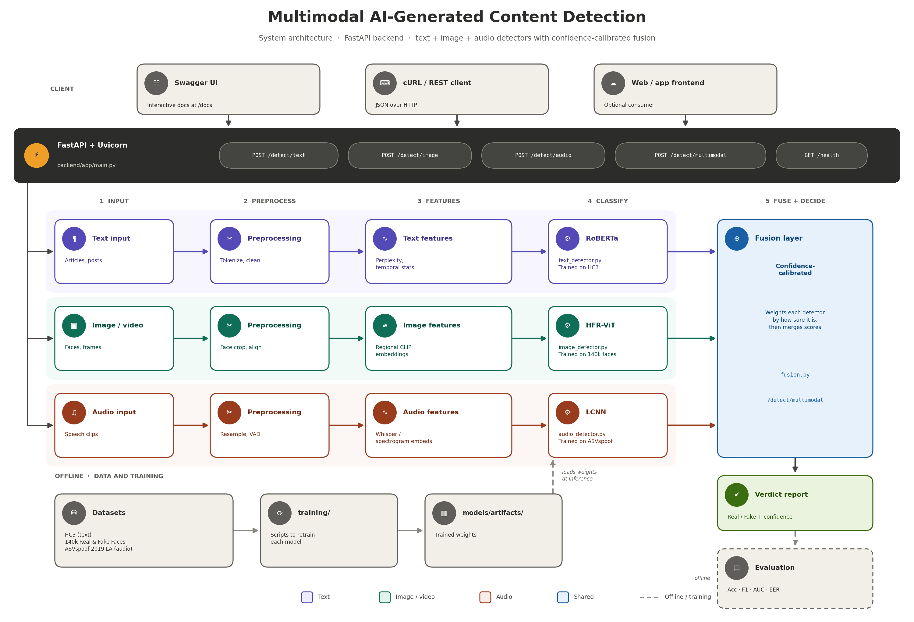

# Multimodal AI-Generated Content Detection
<p align="center">


A FastAPI backend that detects AI-generated or manipulated **text**, **images**, and **audio**, and combines the three into a single confidence-calibrated verdict: **Real** or **Fake**.



---

## Table of Contents

- [Features](#features)
- [How It Works](#how-it-works)
- [Tech Stack](#tech-stack)
- [Project Structure](#project-structure)
- [Setup and Installation](#setup-and-installation)
- [Running the API](#running-the-api)
- [API Endpoints](#api-endpoints)
- [Datasets](#datasets)
- [Training](#training)
- [Evaluation](#evaluation)
- [Known Limitations](#known-limitations)
- [Roadmap](#roadmap)
- [Contributing](#contributing)
- [Author](#author)

---

## Features

- Detects AI-generated **text** (articles, posts)
- Detects AI-generated or manipulated **images** (faces, video frames)
- Detects AI-generated or spoofed **audio** (speech clips)
- **Multimodal fusion** that weighs each detector by how confident it is
- Interactive API docs with Swagger UI
- Retrainable models, with training scripts for each modality

---

## How It Works

1. A client sends text, an image, or an audio clip to a `/detect/*` endpoint.
2. **Preprocessing** cleans the input for its modality:
   - Text: tokenize and clean
   - Image: face crop and alignment
   - Audio: resample and voice activity detection (VAD)
3. **Feature extraction** builds signals for the detector:
   - Text: perplexity and temporal statistics
   - Image: regional CLIP embeddings
   - Audio: Whisper or spectrogram embeddings
4. A **per-modality classifier** produces a real/fake score.
5. The **fusion layer** (`fusion.py`) merges the scores into one verdict with a confidence value.
6. The API returns the result as JSON.

> The diagram shows the target design (RoBERTa, HFR-ViT, LCNN). The trained baseline models in `backend/app/models/artifacts/` are serialized with `joblib`.

---

## Tech Stack

| Layer | Technology |
| --- | --- |
| API | FastAPI, Uvicorn |
| Language | Python 3.10+ |
| Models | Per-modality detectors (text, image, audio) |
| Model storage | `joblib` artifacts |
| Fusion | Confidence-calibrated late fusion |
| Docs | Swagger UI (OpenAPI) |

---

## Project Structure

```
Deepfake_Detection/
├── architecture.png                # System architecture diagram
├── backend/
│   ├── app/
│   │   ├── main.py                 # FastAPI app and endpoints
│   │   ├── fusion.py               # Confidence-calibrated fusion logic
│   │   ├── models/
│   │   │   ├── text_detector.py    # Text inference
│   │   │   ├── image_detector.py   # Image inference
│   │   │   ├── audio_detector.py   # Audio inference
│   │   │   └── artifacts/          # Trained model files
│   │   └── training/
│   │       ├── train_text.py
│   │       ├── train_image.py
│   │       └── train_audio.py
│   ├── scripts/
│   │   └── load_unified_dataset.py # Dataset download instructions
│   ├── build_mini_protocol.py
│   ├── check_protocol.py
│   ├── download_mini_audio.py
│   ├── test_inference.py
│   ├── verify_audio.py
│   └── requirements.txt
├── .gitignore
└── README.md
```

---

## Setup and Installation

**Prerequisites:** Python 3.10 or newer, Git.

```bash
# Clone the repo
git clone https://github.com/masanebhumika-alt/deepfake-detection-multimodal.git
cd deepfake-detection-multimodal/backend

# Create and activate a virtual environment
python -m venv venv
venv\Scripts\activate          # Windows
# source venv/bin/activate     # macOS / Linux

# Install dependencies
pip install -r requirements.txt
```

---

## Running the API

```bash
uvicorn app.main:app --reload --port 8000
```

Then open [http://127.0.0.1:8000/docs](http://127.0.0.1:8000/docs) for the interactive Swagger UI.

---

## API Endpoints

| Endpoint | Method | Description |
| --- | --- | --- |
| `/detect/text` | POST | Detect AI-generated text |
| `/detect/image` | POST | Detect AI-generated or manipulated images |
| `/detect/audio` | POST | Detect AI-generated or spoofed audio |
| `/detect/multimodal` | POST | Combine text, image, and audio into a fused verdict |
| `/health` | GET | Health check |

### Example request (text)

```bash
curl -X POST "http://127.0.0.1:8000/detect/text" \
  -H "Content-Type: application/json" \
  -d '{"text": "Your text here"}'
```

### Example request (image and audio)

Image and audio endpoints take file uploads. Check the exact field names in the Swagger UI at `/docs`.

```bash
curl -X POST "http://127.0.0.1:8000/detect/image" -F "file=@face.jpg"
curl -X POST "http://127.0.0.1:8000/detect/audio" -F "file=@clip.wav"
```

### Example response

```json
{
  "label": "Fake",
  "confidence": 0.91
}
```

---

## Datasets

| Modality | Dataset |
| --- | --- |
| Text | [HC3 (Human-ChatGPT Comparison Corpus)](https://huggingface.co/datasets/Hello-SimpleAI/HC3) |
| Image | 140k Real and Fake Faces (Kaggle) |
| Audio | ASVspoof 2019, Logical Access (Kaggle) |

Datasets are not included in this repo because of their size. See `backend/scripts/load_unified_dataset.py` for download instructions.

---

## Training

Retrain each model with the scripts in `backend/app/training/`:

```bash
cd backend
python -m app.training.train_text
python -m app.training.train_image
python -m app.training.train_audio
```

Trained files are saved to `backend/app/models/artifacts/`.

### Quick checks

```bash
python test_inference.py     # Run a sample inference
python verify_audio.py       # Verify the audio pipeline
python check_protocol.py     # Validate the audio protocol file
```

---

## Evaluation

Models are compared with these metrics:

| Metric | Meaning |
| --- | --- |
| Accuracy | Share of correct predictions |
| F1 | Balance of precision and recall |
| AUC | Ranking quality across thresholds |
| EER | Equal error rate, standard for spoof detection |

---

## Known Limitations

- The text detector generalizes narrowly beyond HC3-style writing.
- The audio detector is trained on studio-quality speech. Accuracy drops on compressed or casual real-world audio.
- The image detector is trained on GAN-generated faces and may generalize differently to diffusion-based or avatar-generation tools.
- This is a **research and academic baseline**, not a production-ready moderation system.

---

## Roadmap

- [ ] Add diffusion-generated faces to the image training data
- [ ] Add video-level temporal analysis
- [ ] Evaluate on compressed and noisy audio
- [ ] Add Docker support
- [ ] Add automated tests and CI

---

## Contributing

Contributions are welcome.

1. Fork the repo
2. Create a branch: `git checkout -b feature/your-feature`
3. Commit your changes: `git commit -m "Add your feature"`
4. Push the branch: `git push origin feature/your-feature`
5. Open a pull request

---

## Author

**masanebhumika-alt**  
GitHub: [@masanebhumika-alt](https://github.com/masanebhumika-alt)
